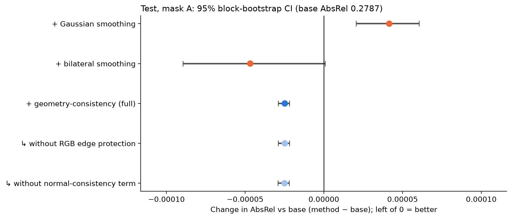
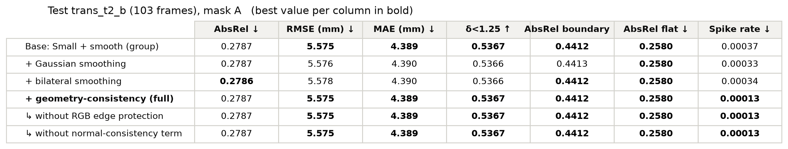
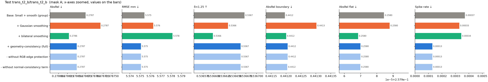
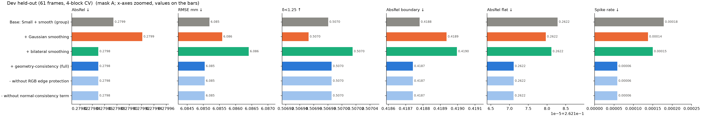
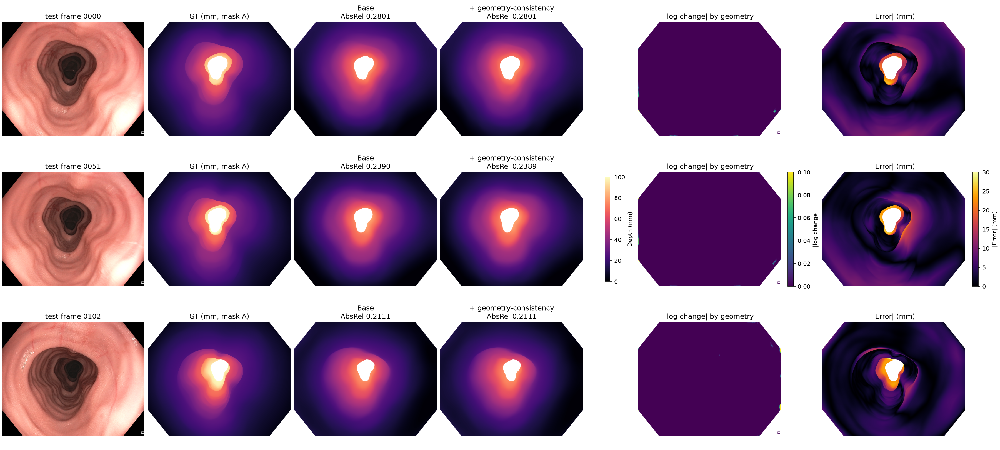

# Geometry-consistency depth correction on DAv2 Small + smooth

**Problem.** A predicted depth map can have locally implausible jumps on an otherwise smooth colon wall.  
**Method.** From the predicted depth only: spike evidence (log-depth vs its 5×5 median) × surface-normal inconsistency (pseudo-normals vs their 7×7 mean). Where both are high, depth is pulled to the local median, unless a strong RGB edge supports the jump (real folds are protected).  
**Ablation.** Base → conventional smoothing (Gaussian, bilateral) → geometry-consistency, plus the full method without RGB edge protection and without the normal-consistency term.

**Protocol (same as the other novelties).** Base = group DAv2 Small 518 + smooth correction fitted on mask-A pixels. Dev `trans_t1_a` (61 frames): 4-block CV with a 2-frame gap; base refitted and filter settings chosen on the fit frames of each fold. Test `trans_t2_b`: base and settings from all dev frames, run once (103 frames). Metrics per frame (`common.compute_metrics`), mean over frames, RMSE = √(mean per-frame MSE). Mask A in the main tables, mask B as a second table. Filters run at 1/4 resolution; all metrics at 1080 × 1350.

> **Result.** Geometry-consistency (full) vs base on test: AbsRel -0.0000 (95% CI [-0.0000, -0.0000], better); largest change of any filter 0.0000 AbsRel.

## Test results, mask A (main)
`trans_t2_b`, 103 frames. Best value per column in **bold**.

| Method | AbsRel ↓ | RMSE (mm) ↓ | MAE (mm) ↓ | δ<1.25 ↑ | AbsRel wall ↓ | AbsRel lumen ↓ | AbsRel boundary ↓ | AbsRel flat ↓ | Spike rate ↓ |
|---|---|---|---|---|---|---|---|---|---|
| Base: Small + smooth (group) | 0.2787 | **5.575** | **4.389** | **0.5367** | 0.3241 | **0.1025** | **0.4412** | **0.2580** | 0.00037 |
| + Gaussian smoothing | 0.2787 | 5.576 | 4.390 | 0.5366 | 0.3242 | **0.1025** | 0.4413 | **0.2580** | 0.00033 |
| + bilateral smoothing | **0.2786** | 5.578 | 4.390 | 0.5366 | **0.3240** | 0.1026 | **0.4412** | **0.2580** | 0.00034 |
| **+ geometry-consistency (full)** | 0.2787 | **5.575** | **4.389** | **0.5367** | 0.3241 | **0.1025** | **0.4412** | **0.2580** | **0.00013** |
| ↳ without RGB edge protection | 0.2787 | **5.575** | **4.389** | **0.5367** | 0.3241 | **0.1025** | **0.4412** | **0.2580** | **0.00013** |
| ↳ without normal-consistency term | 0.2787 | **5.575** | **4.389** | **0.5367** | 0.3241 | **0.1025** | **0.4412** | **0.2580** | **0.00013** |

## Test results, mask B
`trans_t2_b`, 103 frames. Best value per column in **bold**.

| Method | AbsRel ↓ | RMSE (mm) ↓ | MAE (mm) ↓ | δ<1.25 ↑ | AbsRel wall ↓ | AbsRel lumen ↓ | AbsRel boundary ↓ | AbsRel flat ↓ | Spike rate ↓ |
|---|---|---|---|---|---|---|---|---|---|
| Base: Small + smooth (group) | **0.2777** | **6.488** | **4.791** | **0.5293** | 0.3242 | **0.1156** | **0.4412** | **0.2580** | 0.00037 |
| + Gaussian smoothing | **0.2777** | 6.490 | 4.792 | 0.5292 | 0.3242 | 0.1157 | 0.4413 | **0.2580** | 0.00033 |
| + bilateral smoothing | **0.2777** | 6.496 | 4.793 | 0.5290 | **0.3241** | 0.1158 | **0.4412** | **0.2580** | 0.00034 |
| **+ geometry-consistency (full)** | **0.2777** | **6.488** | **4.791** | **0.5293** | **0.3241** | **0.1156** | **0.4412** | **0.2580** | **0.00013** |
| ↳ without RGB edge protection | **0.2777** | **6.488** | **4.791** | **0.5293** | **0.3241** | **0.1156** | **0.4412** | **0.2580** | **0.00013** |
| ↳ without normal-consistency term | **0.2777** | **6.488** | **4.791** | **0.5293** | **0.3241** | **0.1156** | **0.4412** | **0.2580** | **0.00013** |

## Is the change real? Paired block bootstrap (test, mask A)
Method − base, 95% CI, 2000 resamples of blocks of 10 neighbouring frames. ✓ consistently better, ✗ consistently worse, ≈ no clear difference (CI includes 0).

| Method | ΔAbsRel ↓ | ΔRMSE (mm) ↓ | Δδ<1.25 ↑ |
|---|---|---|---|
| + Gaussian smoothing | +0.00004 [+0.00002, +0.00006] ✗ | +0.00085 [+0.00062, +0.00114] ✗ | -0.00004 [-0.00007, -0.00002] ✗ |
| + bilateral smoothing | -0.00005 [-0.00009, +0.00000] ≈ | +0.00272 [+0.00159, +0.00358] ✗ | -0.00007 [-0.00015, +0.00001] ≈ |
| + geometry-consistency (full) | -0.00002 [-0.00003, -0.00002] ✓ | -0.00034 [-0.00043, -0.00025] ✓ | -0.00001 [-0.00001, -0.00000] ✗ |
| ↳ without RGB edge protection | -0.00002 [-0.00003, -0.00002] ✓ | -0.00034 [-0.00043, -0.00025] ✓ | -0.00001 [-0.00001, -0.00000] ✗ |
| ↳ without normal-consistency term | -0.00002 [-0.00003, -0.00002] ✓ | -0.00034 [-0.00043, -0.00025] ✓ | -0.00001 [-0.00001, -0.00000] ✗ |

Base for reference: AbsRel 0.2787. A consistent change can still be negligible in size.

## Dev held-out results (4-block CV on `trans_t1_a`, mask A)

| Method | AbsRel ↓ | RMSE (mm) ↓ | MAE (mm) ↓ | δ<1.25 ↑ | AbsRel wall ↓ | AbsRel lumen ↓ | AbsRel boundary ↓ | AbsRel flat ↓ | Spike rate ↓ | Folds better than base |
|---|---|---|---|---|---|---|---|---|---|---|
| Base: Small + smooth (group) | 0.2799 | **6.085** | **4.715** | **0.5070** | **0.3172** | 0.1448 | 0.4188 | **0.2622** | 0.00018 | – |
| + Gaussian smoothing | 0.2799 | 6.086 | 4.716 | **0.5070** | 0.3173 | 0.1448 | 0.4189 | **0.2622** | 0.00014 | 2/4 |
| + bilateral smoothing | **0.2798** | 6.086 | **4.715** | **0.5070** | **0.3172** | **0.1447** | 0.4190 | **0.2622** | 0.00015 | 3/4 |
| **+ geometry-consistency (full)** | **0.2798** | **6.085** | **4.715** | **0.5070** | **0.3172** | 0.1448 | **0.4187** | **0.2622** | **0.00006** | 4/4 |
| ↳ without RGB edge protection | **0.2798** | **6.085** | **4.715** | **0.5070** | **0.3172** | 0.1448 | **0.4187** | **0.2622** | **0.00006** | 4/4 |
| ↳ without normal-consistency term | **0.2798** | **6.085** | **4.715** | **0.5070** | **0.3172** | 0.1448 | **0.4187** | **0.2622** | **0.00006** | 4/4 |

## Settings (chosen on dev only)

| Filter | Chosen on all 61 dev frames |
|---|---|
| gauss | sigma = 0.5 |
| bilateral | sc = 0.05 |
| geometry | tau = 0.02, ang0 = 5.0, lam = 0.0, iters = 3 |

Base on all dev: depth = 13.2505 · (−pred) + 64.1285 mm, smooth corrections [1.189, -4.104, 1.71, 23.634] mm at 10 / 30 / 50 / 70 mm.

## Figures

**Main table (test, mask A)**

**Ablation, test**

**Ablation, dev held-out**

**Test examples**

## Files

| File | Contents |
|---|---|
| `test_summary.csv` | test results, masks A and B (all columns) |
| `dev_cv_summary.csv` | dev held-out results, masks A and B, folds better than base |
| `block_bootstrap_test.csv` | paired block bootstrap vs base (test, mask A) |
| `per_frame_test.csv`, `per_frame_dev_cv.csv` | per-frame scores |
| `tuning_dev.csv`, `params_dev.json` | every setting tried on dev, chosen settings, base parameters |
| `GeoConsistency_on_SmallSmooth_summary.csv` | group summary format (`common.save_summary`) |
| `run_info.json`, `test_done.json` | versions, device, date of the single test run |
| `results_table_test.csv` | the main table, rounded |

Run on cpu, Python 3.13.14, torch 2.15.0+cpu, transformers 5.22.1; test run 2026-11-01T16:35:36.
